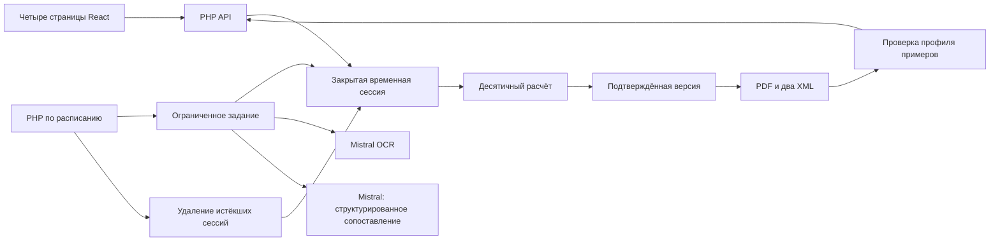

# Design

## Context

Мотивация и границы продукта описаны в [proposal.md](proposal.md). Это новый проект: кода и существующих спецификаций нет; `AGENTS.md`, `docs/data-services.md` и `docs/CODE-STANDARTS.md` на момент подготовки пусты. Решения ниже фиксируют согласованный Explore, а не результаты уже выполненной реализации.

### Материалы и достоверность

| Материал | Наблюдение из Explore | Следствие для реализации |
|---|---|---|
| `reference/rules/DT_2026.docx` | Текстовая инструкция ДТ, в том числе импорт, раздел II, пп. 14–15; около 1739 абзацев | Основа правил граф и обязательности; дата имени файла сама по себе не доказывает полноту актуализации |
| `source-documents/инвойс.pdf`, `смр.pdf`, `отказной по СЭС.pdf` | Сканы без полезного текстового слоя; печати, рукописные реквизиты, таблицы | Нужен OCR, пропуски и неуверенные фрагменты требуют проверки |
| `брокерский договор.pdf` | Три страницы; имеющееся текстовое представление содержит ошибки, визуально читается лучше | Не считать наличие извлечённого текста достаточным качеством; проверять номер и даты |
| `договор+с+УНК.pdf`, `Приложение 25.pdf` | RU/EN, договор 777-ЕА, спецификация 25, УНК; условия и единицы отличаются от инвойса | Сохранять роли, даты, единицы и контекст поставки |
| `платеж+13.10.2026.pdf`, `Акт идентификации.pdf` | Текст, RU/KZ/EN и таблицы; платеж 393 и акт 2587 | Не путать оплату продавцу с таможенным платежом; документ со списком веществ связывать с подходящим товаром |
| `экспортная.pdf` | Китайская табличная декларация, читаемый текст; 26792 кг брутто, 24480 кг нетто | Не выбирать массу по большинству документов; сохранить китайское основание и единицы |
| `тд.pdf` | Один повёрнутый сфотографированный лист: опись документов транзитной декларации, не полная ТД; часть номера рукописная | Не восстанавливать отсутствующую ТД и полный номер из готовой ДТ |
| `expected-output/ДТ 55411_281026_0028206.pdf` | Шесть страниц: основной лист и продолжения граф 18/30/54, 44, платежей и описания 31 | Это образец зарегистрированной ДТ; шесть страниц PDF не равны шести листам графы 3 |
| Два XML в `expected-output/` | ДТ с оболочкой Keden и ДТС-1 разных версий типов; схемы отсутствуют | Два независимых профиля сериализации и XSD; отдельные проверки оболочки |
| `source-documents/example2/инвойс.jpg`, `упаков.jpg` | Скан инвойса 2601011274, только стр. 1 из 3; упаковочный лист; DE/EN, 1200 кг нетто, 1248 кг брутто, 2 паллеты, 2844 EUR | Не выдумывать страницы 2–3; не смешивать юридический и адрес доставки покупателя |
| `example2/авиа.pdf`, `инвойс за транспортировку.pdf` | AWB 235-19031073 и отдельный счёт IAHLKZ2601085; разные суммы перевозки | Отделять этапы и виды расходов, исключать двойное включение |
| `example2/контракт.pdf`, `СГР.pdf` | Контракт 12 сканированных страниц RU/EN, последние страницы повёрнуты; СГР 2 страницы со списками продукции | Обрабатывать весь документ частями; СГР и производителей сопоставлять по конкретному товару |
| `example2/2601011274.xlsx` | Ячейки читаются; строка 4 — товар, строка 5 — итоги. I4=2975 при заголовке «кол-во штук» и J4=«кг»; L4=1200, M4=1248, Q4=2844. Декоративные XML рисунков распаковываются примерно в 25 МБ | Потоковое чтение ячеек без рисунков; конфликт количества не подменяет массу; итоги не создавать как товар |
| `example2/Выпуск KT&G KAZAKHSTAN  (HB Fuller inv 2601011274) Авиа.pdf` | Зарегистрированная ДТ на один товар, FCA NIENBURG, воздушная перевозка, стоимость с перевозкой/страхованием | Только независимый материал проверки, исключённый из OCR-входов тестового корпуса |
| `reference/interface/` | Фотографии Keden с уже выпущенной ДТ | Источник состава сведений, не требование повторять все модули Keden |

Полные пути в первых строках таблицы относятся к `reference/`; сокращённые имена — к `reference/source-documents/`. Первый набор: 10 PDF, 19 страниц. Оба реальных комплекта содержат по одному товару; обработку нескольких товаров проверять дополнительными контролируемыми фикстурами.

## Goals / Non-Goals

**Goals:**

- Отделить документальные факты, предложения AI, выбранные пользователем значения и программные результаты.
- Иметь один реестр полей и одну подтверждённую версию для интерфейса, проверок и выходов.
- Поместить обработку в ограничения XS без постоянного процесса и сохранить возможность проверки отдельных правил.

**Non-Goals:**

- Не строить универсальную платформу таможенного оформления, собственный OCR или юридическую экспертную систему.
- Не принимать готовую зарегистрированную ДТ за первичный источник, не эмулировать действия таможни.
- Не добавлять инфраструктуру постоянного хранения, сервис тарифов, автоматическую загрузку курсов, отдельный редактор справочников или операционный личный кабинет. Остальные ограничения — в proposal.

## Decisions

### Уточнение формы и заполнения от 13.11.2026

Форма проверки компактная: на desktop две колонки полей внутри каждого раздела/товара; инпуты 26 px вместо 54 px, основной шрифт полей 12 px и сокращённые отступы. До 1050 CSS px — одна колонка. Единственный допустимый кандидат автоматически заполняет поле без кнопки выбора; источник доступен в раскрывающейся подсказке. Кнопки предназначены для нескольких допустимых вариантов. Непрошедшие проверку предложения остаются предупреждениями, не создают ложный конфликт с единственным корректным значением. Эквивалентные названия стран сводятся к коду с сохранением всех цитат.

Перед созданием сущностей проверяются кандидаты: неиспользуемый/неподтверждённый entity не создаёт пустую строку. Перечень продукции разрешительного документа не доказывает состав поставки и не создаёт новые товары. Сопоставлению передаются уже найденные товары, допустимые значения и ограничения полей; подтверждённые сведения поддерживающего документа могут относиться к существующему товару. Ручные/выбранные значения сохраняются. Изменение prompt инвалидирует кэш сопоставления, а не успешный OCR. Текущая сохранённая `sesssion.json` — промежуточный снимок: итоговая полнота последнего серверного результата по нему не заявляется.

### D1. PHP backend и готовый статический frontend для PS.kz XS

Уточнение ТН ВЭД от 13.11.2026: предоставленный JSON содержит 18014 записей/13294 конечных десятизначных кода. Локальный `bin/build-tnved.php` создаёт компактный каталог и отдельный индекс проверки кодов в `resources/tnved/`; большие метаданные покрытия не загружаются в runtime. Автоподбор использует уникальное точное название; нечёткий поиск даёт варианты, не выбирая первый из ограниченного списка. Существующий AI mapping может вернуть русский поисковый перевод с цитатой названия, но не справочный код; новые свойства товара из перевода не принимаются. Русские названия не заменяются AI-пересказом, общие английские названия требуют уточнения. Код берётся только из каталога, имеет отдельное справочное происхождение/версию и отображается в существующем поле товара. Правка описания пересматривает автоматический подбор; документальные и ручные коды сохраняют приоритет. Код, отсутствующий в каталоге, не принимается автоматически и не заменяется молча, если он явно указан в документе. Ставки, юридические примечания и подтверждённая актуальность каждого кода в JSON отсутствуют. Детали — в `docs/tnved-selection.md`.

Цель размещения — классический виртуальный хостинг Plesk **XS**. По документации PS.kz: 256 МБ ОЗУ, 1 ГБ диска, 5 одновременных PHP/cgi-процессов сайта; Python/Node.js в классической линейке отсутствуют, вызовы shell-процессов из PHP ограничены. Поэтому прежняя исследовательская идея Python/FastAPI заменена PHP. [Ограничения PS.kz](https://docs.ps.kz/ru/hosting/website-hosting/getting-started/hosting-limits)

| Часть | Выбор и обоснование | Рассмотренная альтернатива |
|---|---|---|
| UI | React + TypeScript, Vite для локальной/CI-сборки; компактный CSS без тяжёлого UI-комплекта | SSR/Next.js требует серверного Node.js; не подходит XS |
| Backend | PHP 8.3, небольшой JSON API, Composer и фиксированные зависимости | FastAPI/Node backend требует смены услуги хостинга |
| HTTP к Mistral | Серверный HTTPS через cURL, ограниченные тайм-ауты, без зависимости от SDK Python | Вызов из браузера раскрывает ключ |
| Числа | `brick/math`, десятичные строки во всех API и JSON | `float` создаёт ошибки денежных вычислений; обязательный BCMath излишне сужает размещение |
| PDF | mPDF, собственный печатный шаблон с фиксированной сеткой граф и управляемыми продолжениями | Headless Chromium/wkhtmltopdf требуют внешних процессов; готовая выпущенная ДТ содержит чужие данные |
| XML | XMLWriter/DOM и libxml для XSD; локальные зависимости схем | Строковая конкатенация ненадёжна для типов, escaping и порядка элементов |
| XLSX/ZIP | ZipArchive + XMLReader для ячеек; ZipArchive для двух выходных XML | Полная загрузка рисунков и книги в объектную модель расходует память XS |
| Состояние | Закрытые каталоги с JSON/файлами и блокировками | БД/Redis/облачное объектное хранилище не требуются MVP |

`brick/math` имеет PHP-реализацию без обязательного GMP/BCMath. Для mPDF нужны совместимая версия, mbstring и gd. Точные версии зависимостей закрепляются lock-файлами при реализации; PHP 8.3 и расширения проверяются на аккаунте до размещения. [brick/math](https://github.com/brick/math), [требования mPDF](https://mpdf.github.io/about-mpdf/requirements-v7.html)

Проверять также curl, fileinfo, dom/libxml, xmlreader/xmlwriter, zip, zlib, запись/блокировки в приватном каталоге, исходящий HTTPS, лимиты upload/post/memory/time, интервал PHP-заданий. Техническая совместимость аккаунта и производительность пока не измерены. XS — целевая площадка тестового MVP, без обещания высокой конкурентной нагрузки.

### D2. Временная файловая сессия и короткие задания

Backend хранит случайный секрет сессии в Secure/HttpOnly/SameSite cookie, а не в URL. Изменяющие запросы проверяют сессию и CSRF/Origin. Файлы именуются сервером, исходное имя — только метаданные. Закрытая конфигурация и временный корень находятся вне document root и вне каталога Git-развёртывания. Нет localStorage с документами и постоянной истории; в активной сессии refresh восстанавливает текущий шаг.

Состояния: `uploading → recognizing → reviewing → calculating → calculated → generating → ready`, плюс адресная ошибка этапа и `expired`. Назад можно вернуться без потери ввода. Распознавание не начинает расчёт, «Создать» не перезапускает AI.

Plesk запускает PHP-скрипт обработчика, который забирает ограниченную порцию работы, сохраняет контрольную точку и завершает процесс. По решению пользователя от 13.11.2026 OCR файлов пакета выполняется параллельно через `curl_multi` внутри одного worker: по умолчанию до 20 запросов, то есть для всех допустимых файлов. Первые части всех документов имеют приоритет перед следующими частями длинного документа. Один worker на сайт удерживает глобальную блокировку от дублирующих cron-запусков; блокировка состояния сессии освобождается перед сетевым ожиданием. Каждый результат сохраняется сразу по завершении. Сопоставление начинается после успешного OCR всех документов; части сопоставления и генерация выполняются последовательно. Атомарная запись JSON через временный файл и rename; lease с тайм-аутом защищает от зависших работ. На финальной записи сверять сессию, срок и ревизию: поздний ответ не воскрешает удалённые данные и не перезаписывает новый черновик.

Опрос браузером читает только состояние, не выполняет OCR и не продлевает хранение. Повторный запуск с тем же набором и ревизией возвращает существующее задание. Если сеть оборвалась после принятия запроса провайдером, точное отсутствие повторного списания гарантировать нельзя: отмечать неопределённое состояние, ограничивать повтор, не объявлять собственный ключ идемпотентности гарантией со стороны Mistral.

Для MVP предполагаются: TTL **2 часа бездействия**, очистка раз в минуту при доступности такого расписания, не более 20 файлов, 10 МБ на файл, 50 МБ входов и 100 страниц на сессию. Это начальные конфигурационные ограничения, не ограничения Mistral; до приёмки уточняются по реальному XS. Ограничить также распакованный размер XLSX, общий временный диск и длительность/число попыток задания. При нехватке места отклонять новую обработку явно. Удаление — по ближайшему циклу; доступ прекращается точно по TTL. При очистке остановить выдачу, пометить сессию истёкшей и исключить дальнейшую публикацию.

Альтернатива — обработка всех файлов в одном HTTP-запросе — проста, но создаёт тайм-ауты и повторы расходов. Очередь в памяти требует постоянного процесса; для XS выбраны временные задания на диске. PHP-задачи поддерживаются планировщиком Plesk. [Настройка cron PS.kz](https://docs.ps.kz/ru/hosting/website-hosting/control-panel/cron-tasks-hosting)

### D3. Два этапа AI и проверяемая прослеживаемость

1. PDF/изображение → Mistral OCR → страницы, текст, таблицы и блоки с координатами. XLSX → программное чтение ячеек. Даже PDF с текстовым слоем проходит единый OCR-путь MVP: наличие слоя не исключает ошибок и печатей.
2. OCR/ячейки + перечень разрешённых полей → Mistral Small → структурированные факты и кандидаты. Backend проверяет схему и свидетельства, нормализует величины, выявляет конфликты и только затем наполняет черновик.

Начальные закреплённые модели: `mistral-ocr-4-1` и `mistral-small-2603`. Версии модели, схемы и prompt сохранять в метаданных сессии; псевдоним latest не использовать как незаметно меняющуюся зависимость. Small 4 поддерживает structured outputs; точность на двух корпусах ещё не проверена. [OCR 4.1](https://docs.mistral.ai/models/ocr-4-1), [Mistral Small 4](https://docs.mistral.ai/models/mistral-small-4-0-26-03)

Для OCR запрашивать `include_blocks`, таблицы и доступную уверенность по блокам, отключить ненужные изображения Base64 в ответе. Нумерацию API с нуля преобразовать в пользовательские страницы с единицы, сохраняя исходный номер при разбиении. Документы передавать параллельными backend-вызовами Base64 без публичного URL: JSON/Base64 формируется потоком, ответы сохраняются во временные приватные файлы сессии с ограничением каждого ответа и общего диска. В памяти разбирается один завершённый ответ. Ошибка одного запроса не отменяет остальные; повторяются только неуспешные части по прежней политике 429/5xx/сетевых ошибок. Документ, не читаемый провайдером после ограниченной повторной обработки, имеет ошибку, а не выдуманный текст. [OCR processor](https://docs.mistral.ai/studio/document-processing/basic_ocr), [OCR API](https://docs.mistral.ai/api/endpoint/ocr), [curl_multi](https://www.php.net/manual/en/function.curl-multi-exec.php)

Документальные аннотации OCR с JSON Schema доступны, но не являются основным способом междокументного сопоставления. Их ограничение в 8 страниц не переносится на обычный OCR: длинный контракт обрабатывается OCR и частями передаётся сопоставлению. Типичные верхние ограничения OCR из документации — около 50 МБ и 1000 страниц; наши пределы существенно меньше. Разбивать по страницам/логическим частям с сохранением ссылок; не обрезать контекст молча. [Аннотации](https://docs.mistral.ai/resources/cookbooks/mistral-ocr-data_extraction), [разбиение документов](https://docs.mistral.ai/resources/cookbooks/mistral-ocr-documentchunking-document_chunking_cookbook)

Для кандидата требуются: допустимый `fieldId`, `scope` поставки/товара/документа, исходное и нормализованное значение, единица/валюта, `documentId`, `page`+`blockId`+цитата либо `sheet`+`cell`, контекст роли/строки. Проверка существования ссылки и совпадения цитаты необходима, но сама по себе не доказывает правильность семантического сопоставления. Поэтому автоматическая подстановка разрешается только для однозначного совместимого факта, без нерешённого конфликта. Уверенность OCR не трактовать как вероятность правильности графы.

Приведение тонн к кг или запятой к десятичной точке — программное преобразование с сохранением исходного текста. Код ТН ВЭД из 8 цифр не дополняется нулями до 10 автоматически; неизвестная ставка или разрешение не выводятся по похожему товару. Роли seller/consignor, buyer/consignee/declarant, адрес регистрации/доставки и суммы всего договора/инвойса — разные поля. Текст документов, в том числе команды для AI, не получает полномочий управлять приложением.

Не использовать `expected-output` и готовый PDF выпуска из example2 в prompt тестового распознавания. Иначе сравнение даст утечку ответов, служебных идентификаторов и неверно высокую оценку качества.

Ошибки 429/временные 5xx: ограниченные повторы с backoff, jitter и учётом Retry-After, если он есть; ждать между заданиями, не блокировать PHP sleep на минуты. 400/401/403 и проблемы баланса требуют исправления причины, а не бесконечного повтора. Некорректный JSON/доказательство — ошибка этапа или исключение кандидата; успешный OCR и ручной ввод сохранять. Тайм-аут, число попыток и предельный объём ответа — конфигурация.

Ориентир цены на 10.11.2026: OCR 4.1 — **$4/1000 страниц**, Small 4 — **$0.15/млн входных и $0.60/млн выходных токенов**. [Цена OCR](https://docs.mistral.ai/models/ocr-4-1), [цена Small 4](https://docs.mistral.ai/models/mistral-small-4-0-26-03)

Первый набор из 19 страниц — около $0.076 только за один OCR-проход, плюс сопоставление и возможные повторы; это оценка, не обещанная цена декларации. Метаданные usage сохранять временно для проверки затрат. Отдельные биллинг-экраны и модуль бюджетов в MVP не входят.

Удаление локальной сессии не означает удаление данных у провайдера; Base64 не гарантирует Zero Data Retention. Настройки хранения Mistral проверяются отдельно в аккаунте; ZDR не заявляется как уже включённый. [Mistral ZDR](https://docs.mistral.ai/admin/monitor-comply/zero-data-retention)

### D4. Единая модель данных, отдельные доказательства и версии

| Сущность | Минимальное содержимое |
|---|---|
| Session | Непредсказуемый id/секрет доступа, createdAt/expiresAt, состояние, ревизия, версии правил и лимиты |
| Document | id, исходное имя, MIME, размер, hash, число страниц/листов, предполагаемый вид, состояние; вид определяется содержимым, не именем |
| Evidence | documentId, page/block/координаты/цитата или sheet/cell; исходная единица, роль и строка |
| Fact / Candidate | Значение, нормализация, fieldId, scope, evidenceIds, результат структурной/смысловой проверки |
| FieldValue | Значение, состояние unknown/selected/manual/notApplicable, candidateId/evidenceIds, признак конфликта и версия правки |
| DeclarationDraft | Общие реквизиты, отдельные роли участников, поставка/маршрут/местонахождение, документы, товары, параметры ДТС и расчёта |
| SourceLine / GoodsItem | Строка инвойса или иной таблицы отдельно от группы товара ДТ; явные связи строк с товарами, устойчивый itemId и порядковый номер для экспорта |
| PresentedDocument | Вид/номер/дата/срок/код представления, ссылки на исходные файлы, связанные itemIds; один файл может подтверждать несколько реквизитов |
| CostComponent / Allocation | Вид расхода/вычета, валюта, сумма, включённость в цену, участок маршрута, evidence, база и доли распределения |
| ValuationMethod1 | Явные ответы ДТС, обоснование применимости, цена/платежи/начисления/вычеты по каждому товару |
| CalculationResult | inputRevision, формулы и их версии, курсы, промежуточные величины/округления, платежи, контрольные суммы и ошибки |
| ConfirmedSnapshot / ArtifactSet | Одна immutable-версия draft+calculation+rules, hash, технические идентификаторы, три файла, результаты проверок и состояние публикации |

Денежные величины, массы и курсы хранить десятичными строками с явной единицей/валютой, идентификаторы и коды — строками, даты — в однозначном формате. `null`, ноль и «не применимо» не смешивать. Временные технические метаданные не превращать в постоянный аудит/историю.

Любая значимая правка увеличивает `dataRevision`. PATCH требует ожидаемую ревизию; при гонке возвращается конфликт без потери новой правки. Повторный AI-проход добавляет кандидаты, но не перезаписывает manual/selected молча. Удаление документа отзывает его кандидаты; выбранные на его основе поля требуют новой проверки. Изменение draft инвалидирует расчёт, подтверждение и выдачу старого комплекта. Результат просроченного job не может стать актуальным.

Минимальные операции API: создание/чтение сессии; добавление/удаление файла; запуск/статус распознавания; получение/изменение draft; validate; calculate; confirm-and-generate; статус генерации и два защищённых скачивания. Механизм заданий не требует публичного незащищённого URL запуска cron.

### D5. Интерфейс и обязательность

Требования к страницам — в [declaration-review](specs/declaration-review/spec.md), загрузке — в [document-session](specs/document-session/spec.md). На широком экране две колонки полей: название и инпут высотой 26 px; несколько допустимых кандидатов — компактные кнопки под своим инпутом. Единственное допустимое значение подставляется без кнопки, источник доступен отдельно. Источники вариантов в tooltip при hover/focus; на touch доступны раскрывающейся подсказкой. Радиокнопок нет. На узком экране одна колонка. Постоянное название поля не заменять placeholder. Ручная правка снимает выделение кандидата.

Реестр поля содержит `id`, scope, подпись/графу, тип и единицу, способ получения (извлечение/расчёт/справочник/ручной), источник правила, requiredWhen, validWhen, зависимости и привязки XML/PDF. Форма, подсказка AI и backend-проверки используют одну версию реестра; клиентская проверка лишь повторяет серверную.

**Обязательные до «Рассчитать» исходные данные:** участники и их применимые реквизиты; процедура и дата расчёта; страны/условия/место поставки; транспорт и местонахождение по применимым правилам; каждый товар, код, происхождение, массы, количество/упаковка, цена/валюта, документы и коды представления; явные ответы ДТС, расходы/вычеты и распределения; необходимые курсы и параметры платежей; данные составителя/полномочий, если требует выбранный профиль. Рассчитываемые итоги на втором шаге не требуются как ручные поля.

**Условно обязательные:** БИН/ИИН по роли и стране; реквизиты представителя/доверенности при таком способе заполнения; номера контейнеров при container=true; виды/идентификация транспорта по этапам; предшествующая процедура при её наличии (не путать с транзитом); дополнительная единица при требовании кода товара; разрешительный документ/льгота/преференция/квота при заявлении соответствующего признака; данные отсрочки при её наличии; зависимые ответы о взаимосвязи, ограничениях, роялти, выручке, добавлениях и вычетах ДТС. Неприменимость фиксируется отдельным состоянием с правилом, не набором фиктивных нулей.

Не считать обязательным каждый существующий элемент XSD или каждую графу бланка. Для ИМ 40 в KZ локальная инструкция исключает/ограничивает ряд граф; графы 10, 13, 27, 28 и служебные графы не превращать в обязательный пользовательский ввод, графа 52 из приведённого перечня относится к Беларуси. Подробная матрица ниже указывает пробелы формата.

Конфликтные важные значения требуют явного выбора или ручного ввода; одинаковые значения объединяются с несколькими источниками. При ошибках показать количество, причину и прокрутить/сфокусировать первое поле. Чужие скрытые поля, неподтверждённые расходы и пустой обязательный ответ не обходят серверную проверку.

### D6. Начальная матрица полей ДТ и ДТС

Классы: **И** — извлекаемое, **Р** — рассчитываемое, **С** — справочное, **М** — ручной ввод/подтверждение; у одного поля возможны разные способы получения. Правило `15(n)` означает подпункт n пункта 15 раздела II локальной инструкции ДТ. Привязки ниже — до уровня семейств; задача реестра детализирует каждое подполье и проверяет реальный XPath по XSD. Отсутствующий в образце элемент прямо отмечен, его имя не считается установленным.

Для краткости: `D` — `gdgdc:GoodsDeclaration`; `S` — `D/cacdo:GDGoodsShipmentDetails`; `I` — `S/cacdo:GDGoodsItemDetails`; `V` — `cvd:CustomsValueDeclaration`; `VI` — `V/cacdo:CVDGoodsItemDetails`. В пути после этих обозначений сохранены локальные имена; namespace берётся из соответствующего XML-профиля, а не из общего глобального словаря. PDF: номер графы означает основную графу и связанные продолжения при переполнении.

| Графа / класс | Правило | Документ и реквизит-источник | Поле формы | XML / PDF |
|---|---|---|---|---|
| 1 — С | 15(1), профиль ИМ 40 | Выбранный сценарий MVP | Тип ИМ, процедура 40, ЭД | `D/DeclarationKindCode`, `CustomsProcedureCode`, `EDocIndicatorCode`; графа 1 |
| 2 — И/М | 15(2) | Инвойс, CMR/AWB: именно отправитель, не автоматически продавец | Участники → отправитель, адрес, страна, идентификаторы | `S/ConsignorDetails`; графа 2 |
| 3 — Р | 15(3) | Количество товаров, правила основного/добавочных листов | Число листов ДТ | `D/PageQuantity`, `I/PageOrdinal`; графа 3 |
| 4 — И/М, условно | 15(4) | Применимые отгрузочные спецификации | Сведения графы 4 | В образце XML отсутствует, сверить XSD; графа 4. Не номер «25» приложения и не число загруженных файлов |
| 5 — Р | 15(5) | Подтверждённые группы товаров | Всего товаров | `D/GoodsQuantity`; графа 5 |
| 6 — И/Р/М | 15(6) | CMR: 136 бочек / 34 паллеты; example2: 2 паллеты | Всего грузовых мест, уровни упаковки | `D/CargoQuantity`; графа 6; не складывать паллеты и бочки |
| 7 — М/С, условно | 15(7) | Применимое основание особенности декларирования | Справочный номер/признак | В примере отсутствует, уточнить XSD; графа 7. Не номер регистрации ДТ |
| 8, 9, 14 — И/С/М | 15(8),(9),(12), п. 14¹–14² | Контракт, инвойс: получатель, ответственное лицо, декларант; БИН и адрес | Три отдельные роли участников; совпадение — явное | `S/ConsigneeDetails`, `FinancialSettlementSubjectDetails`, `D/DeclarantDetails`, `EqualIndicator`; соответствующие графы |
| 11 — И/С/М | 15(10) | Контракт/инвойс: страна контрагента по сделке | Торгующая страна | `S/TradeCountryDetails`; графа 11 |
| 12 — Р | 15(11) | Сумма стоимости подтверждённых товаров | Общая таможенная стоимость | `S/CustomsValueAmount`; графа 12 |
| 15, 15a/b, 17, 17a/b — И/С/М | 15(13),(14),(16),(17) | Транспортные документы и подтверждённый маршрут | Страны отправления/назначения и коды | `S/DepartureCountryDetails`, `DestinationCountryDetails`; графы 15/17, b только по применимому правилу |
| 16, 34 — И/С/М | 15(15),(32) | Инвойс, происхождение из экспортной, СГР/иные документы по товару | Происхождение по товару и сводное | `S/OriginCountryDetails`, `I/OriginCountryDetails`; графы 16/34. Сводное значение при разных странах — по правилу, не первая страна |
| 18, 21 — И/С/М | 15(18),(21) | CMR: 944AKU11/99ADO11; AWB: нужный участок воздушной перевозки | Транспорт прибытия и активный на границе, регистрация | `S/GDConsignmentDetails/ArrivalDepartureTransportDetails`, `BorderTransportDetails`; графы 18/21 |
| 19 — И/М | 15(19) | Контейнерные/транспортные документы, подтверждение пользователя | Признак контейнера; номера при наличии | `.../ContainerIndicator`, номера в соответствующей ветви XSD; графа 19/31 |
| 20 — И/С/М | 15(20) | Инвойс/спецификация: CPT ALMATY; example2 FCA NIENBURG | Incoterms и место поставки | `S/DeliveryTermsDetails`; графа 20; также `V/DeliveryTermsDetails` |
| 22 — И/Р/С/М | 15(22) | Инвойсы и подтверждённые строки: USD 37454.40 / EUR 2844.00 | Валюта и сумма инвойсов | `S/CAValueAmount` и currencyCode; графа 22 |
| 23 — С/М | 15(23) | Подтверждённый курс НБ РК на применимую дату и кратность | Курс валюты, дата, единицы котировки | В образце ДТ отдельный путь не установлен; `PriceCurrencyRate` в ДТС подтверждён. Графа 23; не `GDFactPaymentDetails/ExchangeRate=1` |
| 24 — С/М | 15(24) | Характер сделки из договора и подтверждение | Код характера и особенности сделки | `S/TransactionNatureDetails`; графа 24 |
| 25, 26 — И/С/М | 15(25),(26) | Фактические этапы маршрута: авто/авиа | Виды транспорта на границе/внутри страны | `UnifiedTransportModeCode` соответствующих транспортных ветвей; графы 25/26 |
| 29 — И/С/М | 15(27) | Пограничные отметки CMR/AWB и справочник таможенных органов | Орган въезда, страна и код | `.../BorderCustomsOfficeDetails`; графа 29. Формат 57503 + KZ и печатный 39857503 преобразуются только заданным правилом |
| 30 — И/С/М | 15(28) | Документы СВХ и отметки; часть данных отсутствует | Код места, таможенный орган, реестровый номер, адрес при необходимости | `S/GoodsLocationDetails`; графа 30. Дополнительные сведения PDF, которых нет в XML, сверить отдельно |
| 31 — И/С/М | 15(29) | Инвойс, спецификация, упаковка, акт/СГР: наименование, назначение, производитель, марка, артикул | Описание товара, группы исходных строк, упаковка, маркировка | `I/GoodsDescriptionText`, `GoodsItemGroupDetails`, `CargoPackagePalletDetails`; графа 31 и продолжение |
| 32 — Р | 15(30) | Подтверждённый список товаров | Порядковый номер товара | `I/ConsignmentItemOrdinal`; графа 32; одинаковый номер связи ДТС |
| 33 — И/С/М | 15(31) | Код в первичных документах; окончательная классификация подтверждается | 10-значный ТН ВЭД, меры/признаки | `I/CommodityCode`, `ProhibitionCode`, `IPOCode`; графа 33/связанные сведения. 35069190 в AWB ≠ автоматически 3506910000 |
| 35, 38 — И/М | 15(33),(36) | Экспортная: брутто 26792; CMR: 27860; нетто 24480. Example2: 1248/1200 | Брутто и нетто по каждому товару | `I/UnifiedGrossMassMeasure`, `UnifiedNetMassMeasure`; графы 35/38 |
| 36 — С/М, условно | 15(34) | Подтверждённые основания льгот/преференций | Четыре составляющие преференции | `I/PreferenceDetails`; графа 36. Кириллическое «ОО» не заменять латинским OO или цифрами 00 |
| 37 — С/М | 15(35) | Процедура 40; предшествующая процедура/особенности по фактам | Текущая, предыдущая, особенность перемещения | `I/CustomsProcedureDetails`; графа 37 |
| 39 — И/С/М, условно | 15(37) | Только при применимой квоте и подтверждении основания | Квота/количество/единица | В образце отсутствует, уточнить XSD; графа 39 |
| 40 — И/М, условно | 15(38) | Предшествующие процедуры/документы, когда требуются | Предшествующий документ и товар | В образце пусто, ветвь по XSD; графа 40. Транзитный документ здесь автоматически не помещать |
| 41 — И/С/М, условно | 15(39) | Дополнительная единица по ТН ВЭД и количество из первички | Количество/код дополнительной единицы | Ветвь дополнительного измерения по XSD; графа 41; не путать с базовой массой |
| 42 — И/Р/М | 15(40) | Стоимость строк инвойса, подтверждённое объединение | Цена товара в валюте инвойса | `I/CAValueAmount`; графа 42 |
| 43 — С/М | 15(41) | Подтверждённая применимость метода 1 | Метод оценки | `I/ValuationMethodCode`; графа 43; также ДТС |
| 44 — И/С/М | 15(42) | Документы поставки: код вида, номер, дата, срок; представление подтверждает пользователь | Повторяемый список документов и связанных товаров | `I/PresentedDocDetails`, `DocumentPresentingDetails/DocPresentKindCode`; графа 44/продолжения |
| 45 — Р | 15(43) | Расчёт ДТС-1 товара | Таможенная стоимость в KZT | `I/CustomsValueAmount`; графа 45; равна результату ДТС этого товара |
| 46 — Р | 15(44) | Цена/расходы до соответствующего базиса границы и курс USD | Статистическая стоимость USD | `I/StatisticValueAmount`; графа 46 |
| 47 — Р/С/М | 15(45) | Базы, ставки/основания, МРП и сбор по дате; формулы | Вид платежа, база, ставка, сумма, особенность | `I/CustomsPaymentDetails`; графа 47/продолжения |
| B — И/Р/С/М, по фактам | 15(46) | Подтверждённые сведения об уплате отдельно от начислений | Уплачено по видам, применимые реквизиты | `S/GDFactPaymentDetails`; графа B. Даты/документы не генерировать из текущей даты |
| 48 — И/С/М, условно | 15(47) | Подтверждённая отсрочка/рассрочка | Вид платежа и сроки | В образце отсутствует, путь по XSD; графа 48 |
| 54 — И/С/М | 15(49) | Данные составителя, полномочия, договор представителя; часть отсутствует | ФИО, должность, контакт, место/дата, доверенность и представитель | `D/SignatoryPersonV2Details`, `SignatoryRepresentativeDetails`; графа 54/продолжение |
| Служебные отметки — не исходные поля | Полномочия таможни | Зарегистрированные образцы только для сравнения | Не присваиваются новой ДТ | Графа A, выпуск, служебные статусы, сведения ЭП не копируются |
| Расширения Keden — С/М | Только структура XML-примера, официальной XSD оболочки нет | Идентификаторы заполняющего/органа/товара — подтверждённые данные, не образец | Орган оформления, RateType, данные заполняющего, Ntincode при применимости профиля | `ccecd:KedenGoodsItemDetails`, `CustomsOfficeCode`, `RateType`, `FillerInformation`; прямой графы PDF может не быть |

Для справочников нужны как минимум страны, валюты/кратности, виды транспорта, таможенные органы, единицы, упаковка, Incoterms, процедуры/особенности, характер сделки, виды и представление документов, льготы/преференции, платежи/способы и меры/признаки товаров. Начальный проверяемый набор хранится в версионированных файлах, с происхождением и датой; отсутствие полного официального справочника отмечается. Редактор справочников и их внешняя синхронизация не входят в MVP. Нельзя трактовать произвольную введённую строку как проверенный справочный код.

ДТС: локального полного правила заполнения нет. Основа структуры — официальный бланк ДТС-1 и предоставленный XML; применимые нормы уточняются при реализации реестра по Решению Коллегии ЕЭК № 160 от 16.10.2018 и формату № 4 от 16.01.2018 с изменениями. Это исходные ссылки для проверки редакций, а не заявление об их уже подтверждённой актуальности. [Официальный бланк ДТС-1](https://eec.eaeunion.org/upload/medialibrary/8e5/vvbwfi7gm7juzxm045cse73v3kh0di5l/DTS_1.pdf)

| Поле ДТС-1 / класс | Правило/смысл | Первичный источник | Поле формы | XML / PDF |
|---|---|---|---|---|
| 1, 2a, 2б — И/М | Продавец, покупатель, декларант по ролям | Контракт/инвойс, реквизиты сторон | Участники ДТС, с общими ссылками на роли ДТ | `V/SellerDetails`, `BuyerDetails`, `DeclarantDetails`; отдельного PDF ДТС нет |
| 3 — И/С/М | Условия поставки | Инвойс/спецификация | Incoterms и место | `V/DeliveryTermsDetails`; связанная графа 20 ДТ |
| 4–6 — И/С/М | Инвойс, договор, дополнительные документы | Инвойсы, платёж 393, контракт/приложения, подтверждающие документы | Список оснований ДТС | `V/CVDMethod1Details/PaymentInvoiceDetails`, `ContractDetails`; ветви дополнительных документов уточнить по XSD |
| 7a–в — М/И, условно | Взаимосвязь, влияние на цену, проверочные величины | Явный ответ и доказательства; готовый XML не доказательство | Взаимосвязь и зависимые ответы | `.../BuyerSellerRelationDetails`; `RelationIndicator` подтверждён примером, остальные подполя по XSD |
| 8a–б — М/И | Ограничения пользования/условия сделки | Контракт и явное подтверждение | Ограничения, условия и их оценимость | `.../GoodsUseRestrictionDetails/RestrictionIndicator`, `ValueConditionIndicator` |
| 9a–б — М/И, условно | Роялти и последующая выручка продавцу | Контракт/лицензии и подтверждение | Роялти/лицензии, возврат выручки, суммы | `.../BuyerSellerRoyaltyFeeDetails`; известны RoyaltyContractIndicator/RoyaltyFeeIndicator/SubsequentResaleIndicator, детализация по XSD |
| 10a–б — Р/М | Листы и составитель | Товары/структура ДТС и пользователь | Составитель, дата, число листов | `VI/PageOrdinal`, `V/SignatoryPersonV2Details`; образец подписанта пустой, не эталон обязательности |
| 11a–б, 12 — И/М/Р | Фактическая цена, косвенные платежи, основа в KZT | Инвойс/платёж, курс, дополнительные основания | Цена, валюта, косвенные платежи, база | `VI/CVDMethod1CalculationDetails/Method1BasisCalculationDetails`: InvoicePriceAmount, NationalInvoicePriceAmount, PriceCurrencyRate, TotalAmount; путь косвенных платежей по XSD |
| 13a–в — И/М | Вознаграждение посредникам, тара, упаковка при применимости | Договор/счёт, условия включения в цену | Отдельные компоненты расходов, includedInPrice | Детализация `Method1AddCostsDetails` по XSD; в образце только TotalAmount=0 |
| 14a–г — И/М | Товары/услуги, предоставленные покупателем | Отдельные подтверждения/ответы | Материалы, инструменты, расходуемые материалы, разработки | Детализация добавлений по XSD, не выдумывать имена отсутствующих элементов |
| 15–16 — И/М | Роялти и часть дохода продавцу | Подтверждённые условия и суммы | Соответствующие добавления | Детализация `Method1AddCostsDetails` по XSD |
| 17–19 — И/М | Перевозка, погрузка, страхование до места ввоза | CPT/FCA, счёт перевозчика/экспедитора, страхование; отдельные этапы | Место и расходы, валюта, источник, доли | `Method1AddCostsDetails/PlaceName`, детали расходов по XSD |
| 20 — Р | Сумма начислений | Подтверждённые компоненты 13–19 | Всего добавлений | `Method1AddCostsDetails/TotalAmount` |
| 21–23, 24 — И/М/Р | Допустимые вычеты: работы после ввоза, внутренняя перевозка, налоги; итог | Выделенные и допустимые расходы с подтверждением | Отдельные вычеты и их сумма | В примере ветвь вычетов отсутствует; установить структуру по XSD, отсутствие не означает запрета вычетов |
| 25 — Р | Стоимость = 12 + 20 − 24 по товару | Программный расчёт | Стоимость KZT и предусмотренный профильный эквивалент | `VI/CustomsValueAmount`, `ExchangeRate`, `ValuationMethodCode`, `CommodityCode`, `ConsignmentItemOrdinal`; графа 45 ДТ |

Неизвестные XPath остаются пробелами. По решению пользователя от 12.11.2026 официальный XSD-контроль переносится за границы MVP: текущий экспорт использует только наблюдаемые в образцах ветки, а данные для отсутствующих веток блокируют создание с адресной ошибкой. Это не препятствует расчёту и редактированию.

### D7. Расчёты, несколько товаров и редактирование результатов

Формулы — направленный граф зависимостей: значения полей и курсы → цена в KZT → начисления/вычеты ДТС → стоимость товара → базы/платежи → итоги. Расчёт каждого узла сохраняет формулу, операнды, точность и результат. При изменении исходных параметров пересчитать все потомки; на сервере повторно проверить актуальную ревизию.

Базовая формула метода 1: `CV_i = basis_i + additions_i − deductions_i`. Каждая денежная компонента конвертируется по своей валюте с учётом кратности. Включённые в цену расходы не добавлять второй раз; исключение расхода из CPT по одному названию условия также недопустимо. При FCA перевозку и страхование разделять по месту ввоза; точка поставки Incoterms и таможенная граница — разные понятия. Подтверждение полного перевозочного плеча Almaty в example2 как допустимого добавления — допущение проверочного сценария, не универсальный вывод из слова FCA.

Общие расходы: предложить распределение по подтверждённой массе или стоимости, либо ввести суммы вручную. Пользователь подтверждает базу до расчёта. Воспроизводимый остаток округления распределять по наибольшим дробным остаткам с устойчивым разрешением равенства по itemId. Общие грузовые места считать по идентичности упаковки, не суммой повторных ссылок товаров.

Основной лист ДТ — один товар; добавочный — до трёх. Для `n ≥ 1` товаров: `extraSheets = ceil(max(0, n−1)/3)`, `PageQuantity = 1 + extraSheets`. Продолжения длинных граф — отдельные страницы PDF, не добавочные листы для этой формулы. Номер листа ДТС рассчитывается отдельно по его форме, не копируется из ДТ; пример VI/PageOrdinal=2 нельзя распространить на любое число товаров без правила формы/XSD. Группы ДТ нельзя автоматически приравнивать к строкам инвойса: проверить название, ТН ВЭД, происхождение и применимые меры/другие существенные признаки, получить подтверждение группировки.

Стартовый платёжный профиль покрывает проверяемые примеры: сбор 1010, адвалорную пошлину 2010, НДС 5060. Дата/МРП/ставки/льготы/формулы — версионируемая конфигурация и подтверждённые параметры, не константы из зарегистрированной ДТ. Распределение сбора для KZ учитывать по локальной инструкции `15(45)`: `(Z + N * B) / Kol_tov`, где N — число добавочных листов ДТ, а не страниц продолжений. Значения Z/B и применимость требуют источника по дате. При формуле платежа вне реализованного профиля выдавать явное ограничение, не имитировать расчёт; пять форм базовых ставок JSON v2 поддержаны отдельной доработкой ниже, акциз остаётся неподдержанным.

Для проверочного профиля примеров НДС считается от CV + пошлина + применимый сбор; юридическую применимость каждого слагаемого сохранить как отмеченное допущение профиля. Статистическая стоимость рассчитывается отдельно на требуемом граничном базисе с USD-курсом; равенство с USD-инвойсом допустимо только если следует из входов.

Деньги граф 12/42/45/46 — два знака по соответствующим правилам; массы — три, для менее 1 г — шесть; дополнительное количество KZ — с требуемой точностью, не обязательное приведение к массе. Сохранять промежуточную точность, округлять в явно указанных узлах. Графа 47 и B имеют разные правила: для B в KZ локальный `15(46)` задаёт математическое округление до целого. Не подгонять округление под противоречивый пример.

**Интерпретация редактирования производной суммы:** инпут результата доступен; ввод пользователя образует проверяемое предложение, запускает пересчёт зависимостей и сравнение с формулой его собственного узла. При расхождении показать рассчитанное значение, операнды и ошибку; «Создать» заблокировано. Пользователь меняет связанные исходные параметры либо принимает рассчитанное значение. Самостоятельный override, скрытая подгонка ставки или произвольная обратная формула исключены. Такое поведение сохраняет возможность корректировки и запрет расхождения с формулой; его стоит проверить пользователю перед реализацией.

### D8. Два XML-профиля, PDF и единый комплект

**Уточнение пользователя от 12.11.2026:** MVP формирует XML на основании двух существующих образцов. Официальные XSD будут подключены отдельным следующим изменением. Отсутствие схем не блокирует поддержанные случаи. Для вычетов ДТС и иных веток, отсутствующих в примере, пользователь выбрал блокировку создания с понятным объяснением; расчёт/редактирование таких данных остаются доступными.

Профиль ДТ сохраняет оболочку `ccecd:KedenGoodsDeclaration` и R.055 v1.2.0, CA v1.10.3, common v0.4.16. Профиль ДТС сохраняет R.038 v1.5.0, CA v1.8.1, common v0.4.14. Элементы и их порядок закрепляются локальным описанием, построенным из образцов, без исходных значений. Namespace не обновляется незаметно. XML не подгружает внешние сущности или сетевые зависимости. Статус: «Профиль примера проверен; XSD не выполнялась». Официальную совместимость и импорт в Keden не заявлять.

Представление начислений ограничено наблюдаемыми ветками и итогами `Method1AddCostsDetails/TotalAmount`; неизвестные детали не выдумываются. Ненулевые вычеты, косвенные платежи или иные условия, требующие отсутствующих веток, дают адресную ошибку экспорта. Поддержанные контрольные сценарии CPT и FCA сохраняют подтверждённую стоимость и итоги начислений. Границы профиля документируются и проверяются отдельно от правил обязательности исходной формы.

Графа 44 связана с товарами и исходными файлами; один выбранный код представления используется в PDF и XML. Коды 0/1/2/3 не выводятся автоматически из факта прикрепления файла. Расширения Keden заполняются подтверждёнными значениями текущей формы, а не константами чужой ДТ.

При подтверждении создаются технические UUID ДТ, ДТС и комплекта. `ReferenceDocumentId` ДТС содержит UUID текущей ДТ; тип и смысл этой ссылки проверены только локальным профилем. Идентификатор `S116510021328`, таможенный регистрационный номер и статус выпуска не копируются и не имитируются. Нумерация товаров согласована во всех форматах.

PDF строится собственным программным шаблоном ДТ через mPDF и локальные Unicode-шрифты: основной лист, до трёх товаров на добавочном листе, связанные продолжения переполняемых граф. Продолжения не увеличивают число форм в графе 3. Отдельный PDF ДТС не создаётся; графа A остаётся без номера регистрации и отметок выпуска/ЭП.

При «Создать» backend повторно проверяет ревизию, данные, расчёт и поддержанность XML-профилем. PDF, оба XML и ZIP создаются только из immutable snapshot. Полный комплект открывается атомарно после всех локальных проверок. Ошибка одного файла не открывает остальные как частичный успех. Скачивание проверяет сессию, TTL, snapshot/hash и актуальность; повторное скачивание не меняет файлы и не вызывает AI. Имена: `declaration.pdf`, `declaration-xml.zip` с `declaration.xml` и `customs-value-declaration.xml`.

### D9. Проверки на предоставленных примерах

Примеры — проверочные свидетельства, не безусловный эталон. Для фикстур фиксировать факт/значение/источник/ожидаемый конфликт/ручное решение отдельно от готового выхода. Секреты и реальный ключ в фикстуры не включать. Проверки SDK/API сначала выполняются на подменённых ответах, затем ограниченным реальным прогоном с приватно настроенным ключом; в рамках этой подготовки реальные вызовы Mistral не выполнялись.

| Проверка / найденное расхождение | Ожидаемый проверяемый результат MVP |
|---|---|
| Брутто 26792 в экспортной, 27860 в CMR и готовой ДТ | Два кандидата с документом и стр. 1; нет выбора по готовой ДТ; нажатие кнопки заполняет поле и разрешает конфликт |
| Документ 10-18/332 | В PDF у представления код 1, в XML ДТ 0; пользователь/правило выбирает один, PDF и XML новой версии совпадают. Проверить и остальные документы, это не единственное расхождение |
| `тд.pdf` — опись | Классификация/основание не обещают полную ТД; сомнительная рукописная часть номера не достраивается из `09013` готового XML |
| Брокерский договор | Не принимать ошибочный текст как окончательный; номер/дата либо подтверждены источником, либо явно требуют ручной проверки |
| Отсутствующие первичные документы | Упаковочный/документ происхождения, запись реестра представителя, доверенность из готового XML не становятся якобы загруженными первичными документами |
| Подписант и доверенность первого примера | В PresentedDocDetails доверенность № 4 от 01.01.2026, в PowerOfAttorneyDetails № 10 от 03.01.2026; телефон XML также отличается от PDF. Не выбирать один вариант без основания |
| Дополнительные затраты первого примера | Нулевые добавления в ДТС не доказывают отсутствие всех расходов: в китайском документе есть поля перевозки CNY 75000 и страхования USD 32.96; проверить смысл/включённость, не складывать автоматически |
| Ответы метода 1 | Значения «0» в готовом ДТС для взаимосвязи/ограничений/роялти не заменяют явные ответы пользователя |
| Первый расчёт | При подтверждённых параметрах: 37454.40 × 455.63 → 17065348.27; пошлина 853267.41; НДС 2871130.51; начислено 3750347.92 KZT |
| Округление графы B | PDF повторяет суммы с копейками, XML содержит 25950/853268/2871131. Локальная инструкция требует математическое округление фактически уплаченных сумм до целого; не копировать округление вверх из XML и не выдавать начисление за факт уплаты |
| Example2: FCA и расходы | При подтверждённых входах 2844 × 508.33 + 2058736.50 + 5222.00 = 3509649.02 KZT; пошлина 175482.45, НДС 593773.04, начислено 795205.49 KZT с указанным профилем |
| Example2: AWB против счёта | AWB 7700.16 EUR и счёт экспедитора 4050 EUR / 2058736.50 KZT не суммируются автоматически; обе суммы сохраняют разный контекст |
| Example2: XLSX против первички | I4=2975 и артикул H4=1000054922 против количества 1200 кг и материала 15022275 из инвойса показываются для проверки; L4/M4 и Q4 имеют источники-ячейки |
| Прочие признаки качества | Различие 99.8% в экспортной и 99.90% спецификации не скрывается, если показатель используется в описании; общий лимит контракта и адрес ship-to не подменяют цену/адрес регистрации |

Минимальная приёмка дополнительно включает:

1. Оба реальных набора проходят четыре шага с предусмотренным ручным дополнением; контрольные номера/даты инвойсов, суммы/валюты, нетто, Incoterms и кандидаты конфликтного брутто распознаются с правильными источниками. Ошибки и пропуски честно измеряются; не принимать реализацию, которая оставляет все контрольные поля пустыми вместо сопоставления.
2. Для каждого автоматически подставленного значения есть действительный источник; для отсутствующих данных нет выдуманного заполнения. Проверка не обещает стопроцентную точность OCR всех символов: сомнительные фрагменты требуют проверки.
3. Отсутствие любого обязательного исходного поля, зависимого ответа или распределения блокирует расчёт и на клиенте, и на backend; правильные 0/«нет» проходят.
4. Изменение курса, цены, расходов или состава товаров пересчитывает все зависимые результаты; несогласованная ручная итоговая сумма блокирует создание. Проверить остатки округления и различие граф 47/B.
5. Синтетические случаи с 2 и 5 товарами подтверждают группировку, распределение, общую упаковку, ссылки документов, номера товаров, добавочные листы и ДТС. Длинные 31/44/54 не теряются в PDF.
6. Оба XML проходят локальные проверки профилей образцов и согласованности PDF/XML; XSD отложена по решению пользователя. Отдельный отчёт о проверке не превращается в третий файл ZIP.
7. Все три файла имеют одну ревизию; гонка редактирования с генерацией, повторные клики и частичная ошибка не публикуют смешанный комплект. Старые результаты после правки недоступны как актуальные.
8. Две сессии изолированы; TTL и очистка работают при закрытом браузере и позднем ответе провайдера. Ключ, OCR, документы и настройки не доступны через frontend/публичные пути.
9. На подготовленном Git-релизе и реальном XS подтверждены PHP-расширения, HTTPS, задания/очистка, загрузка обоих комплектов, генерация и отсутствие превышения выделенной памяти/диска. Записать время этапов, пиковую память и фактический usage; SLA до измерений не обещать.

## Risks / Trade-offs

- **Неполные правила ДТС, справочники и актуализация локальной инструкции** → начать с явно версионированного предварительного реестра и профиля двух примеров; спорные положения сообщать пользователю в чате и фиксировать рядом с правилом. Не делать согласование брокером предварительным условием разработки; новые требования после тестирования оформляются отдельно.
- **Нет XSD в репозитории** → текущий MVP проверяет профиль образцов; официальные схемы подключаются следующим изменением. Не утверждать успешную XSD-проверку. Ненаблюдаемые ветки блокировать с объяснением.
- **Нет точной схемы расширений Keden** → использовать отдельный адаптер примера, не объявлять совместимость. Точный формат и реальный импорт — последующая проверка после предоставления пользователем.
- **Ограниченная память/процессы XS** → один PHP-worker с параллельным сетевым OCR и потоковыми телами запросов; разбор ответов, сопоставление и генерация последовательно. Ограничить входы/ответы/распаковку и общий диск. На реальном XS проверить время/память и ограничения провайдера; не менять услугу без решения пользователя.
- **Интервал cron добавляет ожидание** → показывать очереди и этапы; не занимать обработкой каждый HTTP-запрос и не скрывать длительное ожидание. Проверить реальный доступный интервал Plesk.
- **AI ошибается при структурно корректном JSON** → проверять свидетельства, контекст и конфликты; ручной контроль обязателен; отдельно измерять покрытие и ошибки на корпусах.
- **Частичный сетевой сбой может повторно тарифицироваться** → контрольные точки, ограниченные попытки, отсутствие повторного OCR при remap; без ложного обещания exactly-once у провайдера.
- **Неоднозначная правка производной суммы** → показывать операнды и несогласованность; не вводить произвольный override и автоматическую подгонку исходной ставки.
- **Примеры содержат юридические/арифметические несогласованности** → сравнивать поля и формулы, а не требовать побайтового совпадения с зарегистрированным файлом.
- **Истечение сессии в ходе работы** → показывать срок сессии кратко, не продлевать опросом; отказывать в выдаче и удалять все материалы; постоянное восстановление после TTL не входит в MVP.
- **Удаление локально и хранение у Mistral различаются** → не обещать ZDR без настройки провайдера и не публиковать документы для получения их OCR.

## Migration Plan

Миграции БД и перенос старых деклараций отсутствуют. Развёртывание выполняется только после отдельного перехода к реализации; текущая задача не публикует проект и не меняет аккаунты.

1. Локально/в CI зафиксировать совместимый PHP runtime, Composer/npm lock-файлы, собрать frontend, установить production-зависимости и подготовить самостоятельный release-каталог. Node/Composer не запускать на XS.
2. Сформировать отдельную Git-ветку/комплект размещения с уже готовым релизом и web-root `public/`; в публичную часть не включать `reference/`, тесты, `.git`, исходные документы, OpenSpec, приватные настройки и runtime-файлы. Приложение и зависимости также не должны отдаваться как статические приватные файлы.
3. В Plesk проверить PHP/расширения/лимиты и доступ к Mistral. Задать document root, приватную конфигурацию с ключом и отдельный writable temp-root вне каталога деплоя. Не использовать раскрытый в переписке ключ как записываемый пример.
4. Подключить подготовленную ветку Git, настроить PHP-обработчик заданий и очистку через планировщик. Пример конфигурации содержит только имена параметров без секретов. На виртуальном хостинге post-deploy команды недоступны, поэтому обязательна готовая сборка. [Git в Plesk PS.kz](https://docs.ps.kz/ru/hosting/website-hosting/control-panel/plesk-github-repository)
5. Выполнить ограниченный smoke-прогон двух наборов и искусственного многотоварного случая, проверить защищённость каталогов, ZIP/PDF/XML и очистку. До успеха не объявлять размещение проверенным.
6. Для отката вернуть предыдущий подготовленный Git-релиз; приватные настройки и temp-root не заменять деплоем. При несовместимости версий формата временного состояния активные сессии явно завершить и очистить; постоянных пользовательских данных для миграции нет.

## Open Questions

### Принятые допущения для проверки перед реализацией

| ID | Принятое решение на текущем этапе | Как будет проверяться |
|---|---|---|
| A1 | PHP 8.3 + React/TypeScript, mPDF, PHP-расписание на XS; это заменяет исходную идею Python | Проверка функций аккаунта и ранний ресурсный прототип; отсутствие серверного Node/Python уже учтено |
| A2 | TTL 2 часа бездействия; стартовые пределы 20 файлов / 10 МБ / 50 МБ / 100 страниц | Измерение на двух наборах; конфигурационные изменения не меняют продуктовые границы |
| A3 | Реестр обязательности и юридические параметры пока предварительные; без нового согласования каждого спорного поля | Покрыть локальные правила, выводить спорные случаи в чат, уточнить после пользовательского теста |
| A4 | Курсы вводятся с датой, кратностью и основанием; базовые ставки JSON v2 подставляются с подтверждением применимости | Проверка отсутствующего курса и новой расчётной даты; отсутствующий факт не заполнять из прошлого примера |
| A5 | Платёжный профиль: 1010, пять формул 2010 из JSON v2 и 5060; акциз и неизвестные формулы отклоняются | Два реальных расчёта и все пять формул; новые XML-ветки не выдумываются |
| A6 | Правка итоговой суммы — проверяемое предложение с пересчётом и исправлением операндов, без независимого override | Демонстрация ввода несовместимой пошлины; согласовать удобство на пользовательском тесте |
| A7 | PDF — ДТ с добавочными листами/продолжениями, ZIP — ровно два XML; отдельного PDF ДТС нет | Проверка состава файлов и четырёх страниц |
| A8 | Связь ДТ–ДТС использует технический идентификатор текущего комплекта; принятие его Keden неизвестно | В текущем MVP проверить UUID локальным профилем; официальную XSD подключить позже; не присваивать S-номер зарегистрированной записи |
| A9 | СГР, письмо СЭС и коды мер не подтверждают применимость ко всем товарам одним названием файла | Проверка товарных строк, содержания документа и явного решения пользователя |

### Что можно уточнить позже без расширения текущего MVP

- Точный профиль импорта/оболочки Keden, допустимость технической ссылки ДТ–ДТС и семантика `Ntincode`/данных заполняющего: пользователь предоставит формат позднее. Текущая приёмка ограничена локальными профилями примеров; XSD отложена.
- Окончательные требования к обязательным полям, специальным случаям ДТС и правилам платежей после проверки MVP пользователем. До этого действует описанный предварительный реестр, без блокировки остальных работ.
- Практические тайм-ауты, интервал PHP-заданий и предельный безопасный объём на фактическом аккаунте XS: определить измерением при реализации/размещении.
- Достаточно ли Small 4 по качеству сопоставления на повреждённых сканах: проверить ограниченным прогоном; изменение модели внутри того же двухэтапного контракта не требует нового бизнес-модуля.

Официальные XSD перенесены на следующий этап по прямому решению пользователя. Проверка последующих редакций правил и справочников остаётся отмеченным уточнением. Ключ не сохранён в этих документах и реальные настройки аккаунтов не проверялись.

### Уточнение 13.11.2026: тарифы и единицы JSON v2

Запрос пользователя расширяет профиль расчёта пошлины: `advalorem`, `specific`, `combined` (max), `combined_sum`, `alternative_minimum` (min/max). Плоские редактируемые операнды товара восстанавливают исходное дерево формулы, без сведения специфической ставки к проценту. Brick BigRational вычисляет и сравнивает компоненты точно; финальный платёж округляется до двух знаков HalfUp. Валюта специфической ставки требует своего подтверждённого курса с номиналом на расчётную дату.

Importer создаёт маленькие тарифные файлы по группам и отдельный контекст. Runtime не загружает 38-МБ исходник и полный текст страниц. У товара `_tariff` хранит код, hash версии, base_rule, единицы, сноски и ссылки; те же сведения входят в общий snapshot. Все effective_rule в исходнике пустые, поэтому автоматически заполняется только базовая ставка с отдельным подтверждением применимости к стране, происхождению, дате, льготам, исключениям Казахстана и сноскам. Изменение контекста/операндов сбрасывает подтверждение. Существующие ручные ставки сохраняются. При отклонении от базовой формулы нужно ручное основание. НДС, сборы, акциз, преференции, исключения ВТО и курсы в JSON отсутствуют и не заполняются из него.

Единицы отчётности по коду обязательны, в восьми кодах их две одновременно. Количества не выводятся из кода/упаковок. Ставка за кг связана с нетто; допускаются только точные преобразования одинаковых физических величин, без превращения пар в штуки, спирта в продукт или колод в карты. Несвязанные количества, включая суммарный объём двигателей, вводятся отдельно. Merge проверяет все параметры ставки и суммирует количества только для отдельных строк; split сбрасывает количества и подтверждение.

Процентные типовые случаи экспортируются прежним XML-профилем. Дополнительные единицы и неадвалорные ставки требуют отсутствующих в образцах веток XML, поэтому создание комплекта блокируется понятным XML_BRANCH_UNSUPPORTED. Это сохраняет ранее согласованную границу до XSD; новый запрос не считается разрешением выдумывать XML.

### Исправление пути заполнения грузовых мест

Пустой список `goods.packageIds`/`declaration.shipmentPackageIds` получает действие создания группы непосредственно у поля. Название, положительное целое количество и выбранные товары сохраняются одним запросом существующего `/api/entities`. Backend проверяет весь ввод до добавления, создаёт одну группу и отмечает ручные связи с поставкой и товарами в той же ревизии. Пустая промежуточная строка не требуется. Общая группа не размножается по товарам; невыбранные товары не получают связь автоматически. На ошибке форма сохраняет ввод. Ссылки товара должны входить в выбранные группы поставки; обязательность не ослабляется.

### Исправление последовательных действий и срока сессии

Blur-сохранение поля не отключает кнопку, на которую пользователь переводит фокус. Изменяющие HTTP-запросы проходят одну очередь, читают текущую ревизию непосредственно перед отправкой, а ошибка одного запроса не блокирует следующие. Локальный ввод обновляется только при изменении значения самого поля, без сброса на каждой общей dataRevision. При разрыве соединения форма остаётся видимой; проверка текущей сессии не создаёт новую и не вызывает OCR. Фактическое истечение требует отдельного явного действия для новой сессии, удалённые данные не восстанавливаются по CSRF или чужому идентификатору.

TTL считается от успешной авторизованной активности, а не всегда от первой загрузки. SessionStore.mutate получает внутренний userActivity, по умолчанию false; HTTP-операции включают его явно, worker и polling — нет. Продление выполняется под тем же lock с сохранением состояния; Application обновляет HttpOnly/SameSite cookie до того же expiresAt. При истечении до операции продление запрещено. Ключи, документы и результаты OCR остаются в прежнем изолированном хранилище, меняются только срок бездействия, черновик и актуальность расчёта.
